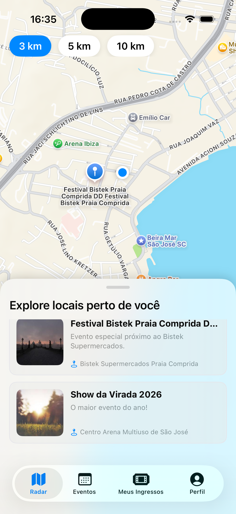
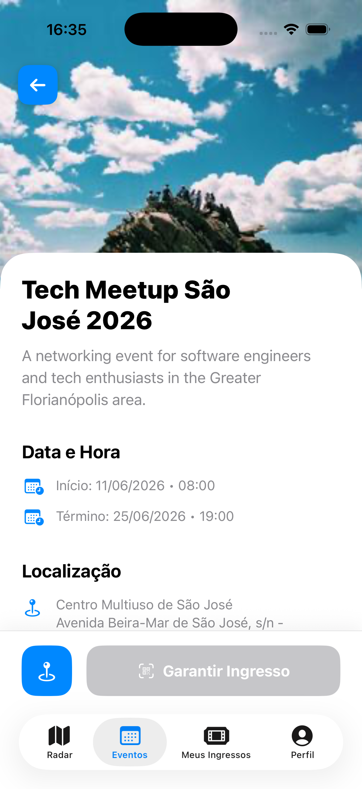
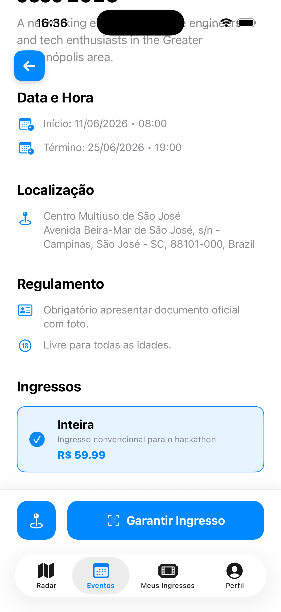

# Eventer App

<p>
  
  
  
  
</p>

### Descrição

Aplicativo iOS nativo para a plataforma **Eventer**. O app permite que os usuários descubram, visualizem detalhes e adquiram ingressos para eventos de diversas categorias. Com forte uso de geolocalização, os usuários podem explorar eventos próximos a eles em um mapa interativo, além de gerenciar seus ingressos diretamente pelo perfil. 

Este projeto consome os serviços da [Eventer-API](https://github.com/Pedroo-Nietoo/Eventer-API).

## Telas do App

<p align="center">
  
  
  
  
  
</p>

## Recursos e Funcionalidades

- **Exploração baseada em Geolocalização:** Mapa interativo (MapKit) para descoberta de eventos próximos com base na localização atual do usuário.
- **Categorização e Filtros:** Navegação simplificada por categorias (Música, Tecnologia, Esportes, etc.) e seção de eventos em destaque.
- **Página de Detalhes Enriquecida:** Visualização completa de informações do evento, incluindo datas, localização, preço, tags e sugestão de eventos similares.
- **Fluxo de Aquisição de Ingressos:** Interface integrada para compra de ingressos conectada de forma assíncrona ao backend (Stripe webhook via API).
- **Gestão de Ingressos:** Aba dedicada ("Tickets") com QR Codes/Barcodes para visualização e gerenciamento dos ingressos adquiridos.
- **Arquitetura MVVM:** Separação clara de responsabilidades entre Views e ViewModels, facilitando a manutenção, injeção de dependências e testes.
- **Interface Fluida e Moderna:** UI construída de forma 100% declarativa utilizando os componentes mais recentes do SwiftUI.

## Tecnologias Utilizadas

- **Swift & SwiftUI:** Construção de interfaces declarativas, responsivas e navegação nativa.
- **MapKit:** Integração de mapas para a funcionalidade de "Explorar" e marcação de eventos (Pins customizados).
- **URLSession / Combine:** Comunicação REST com a Eventer API e gerenciamento de estado assíncrono.
- **Gerenciamento de Imagens:** Carregamento assíncrono e cache de imagens dos eventos (via CDN/AWS S3).

## Pré-requisitos

Para executar este projeto localmente, você precisará de:

- **[Xcode](https://developer.apple.com/xcode/)** (v15.0 ou superior).
- **macOS** (Sonoma 14.0 ou superior recomendado).
- Dispositivo rodando **iOS 16.0+** (ou Simulador do Xcode).
- A **[Eventer-API](https://github.com/Pedroo-Nietoo/Eventer-API)** rodando localmente ou linkada ao ambiente de desenvolvimento/produção.

## Configuração do Projeto

1. Clone o repositório:
```bash
$ git clone https://github.com/Pedroo-Nietoo/Eventer-App.git
$ cd Eventer-App
```

2. Abra o projeto no Xcode:
```bash
$ open Eventer-App.xcodeproj
```

3. **Configuração de Ambiente:**
   - Verifique o arquivo de configuração de endpoints na pasta do projeto (ex: `APIConfig.swift` ou `Config.plist`).
   - Adicione a URL base da sua API local (ex: `http://localhost:3000/api`) ou a URL do ambiente de demonstração.

4. **Executando:**
   - Selecione um simulador (ex: iPhone 15 Pro) ou um dispositivo físico conectado no Xcode.
   - Pressione `Cmd + R` (ou clique no botão de "Play") para compilar e rodar o projeto.

## Estrutura do Projeto

```text
Eventer-App/
├── App/                # Ponto de entrada e ciclo de vida do App
├── Views/              # Telas em SwiftUI organizadas por feature (Home, Map, Event, Profile)
├── ViewModels/         # Lógica de apresentação e controle de estado
├── Models/             # Estruturas de dados (Event, Ticket, User) decodificáveis (Codable)
├── Services/           # Camada de rede e chamadas de API
├── Components/         # Componentes de UI reutilizáveis (Cards, Botões, Tags)
└── Utils/              # Extensões, formatadores (Data/Moeda) e constantes
```

## Dependências do Backend

Para que o app funcione com o ciclo completo de dados (imagens, checkout, etc.), certifique-se de que a API está devidamente configurada com:
- **PostgreSQL** e **Redis** ativos.
- Integração com **AWS S3 / CloudFront** para carregamento de mídia.
- Integração com **Stripe** para habilitar o fluxo de compra de ingressos.

## Licença

Este projeto está sob a licença [MIT](https://github.com/Pedroo-Nietoo/Eventer-App/blob/main/LICENSE).

<p align="center">
  Desenvolvido por <a href="https://github.com/Pedroo-Nietoo">Pedro Nieto</a>.
</p>
